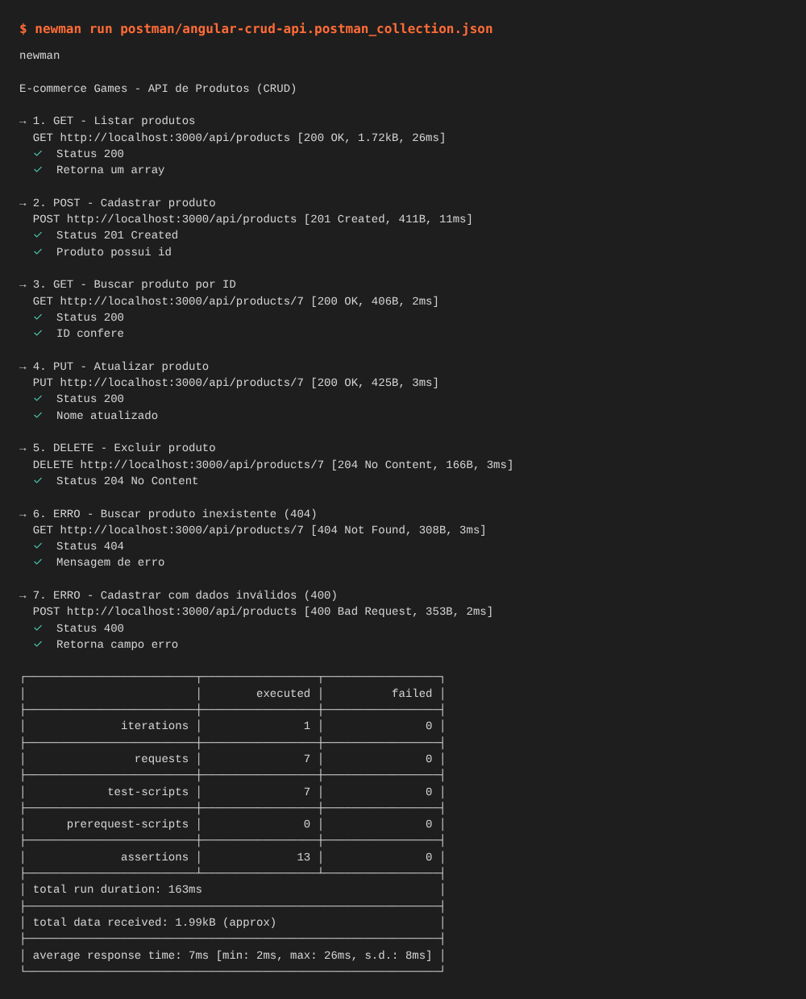
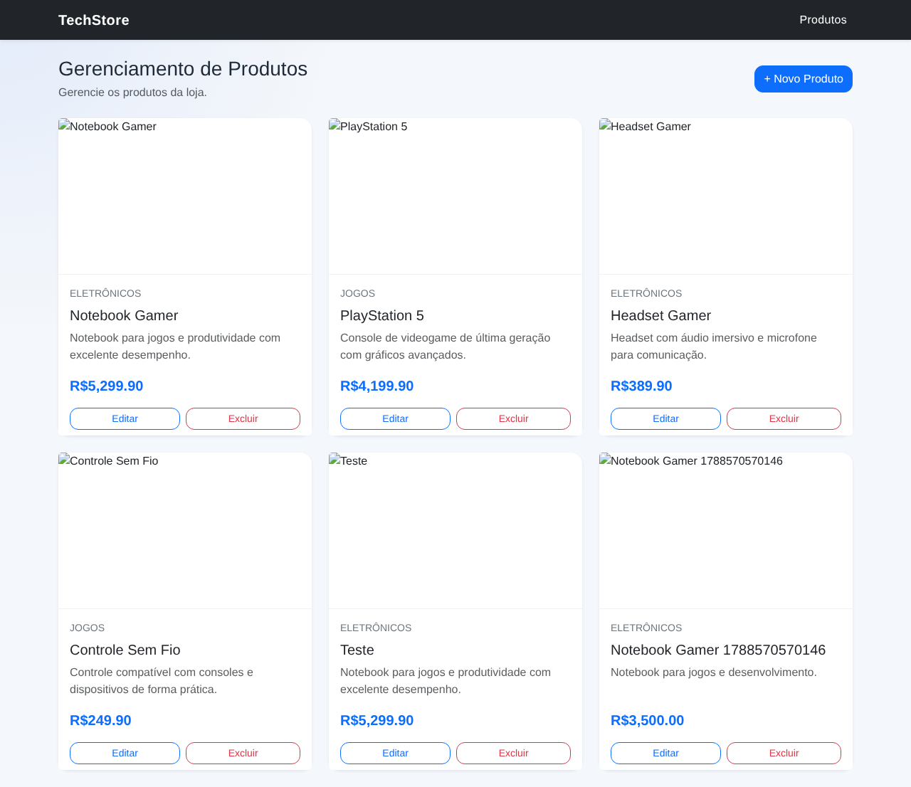
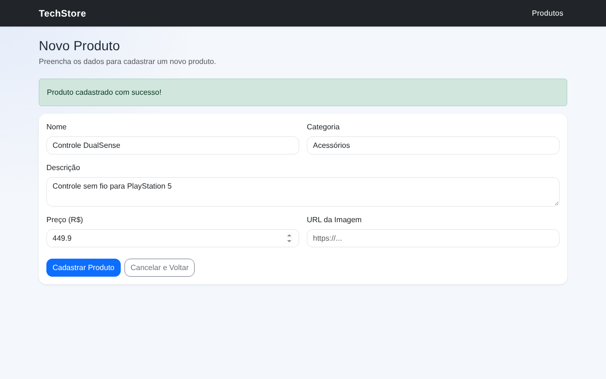
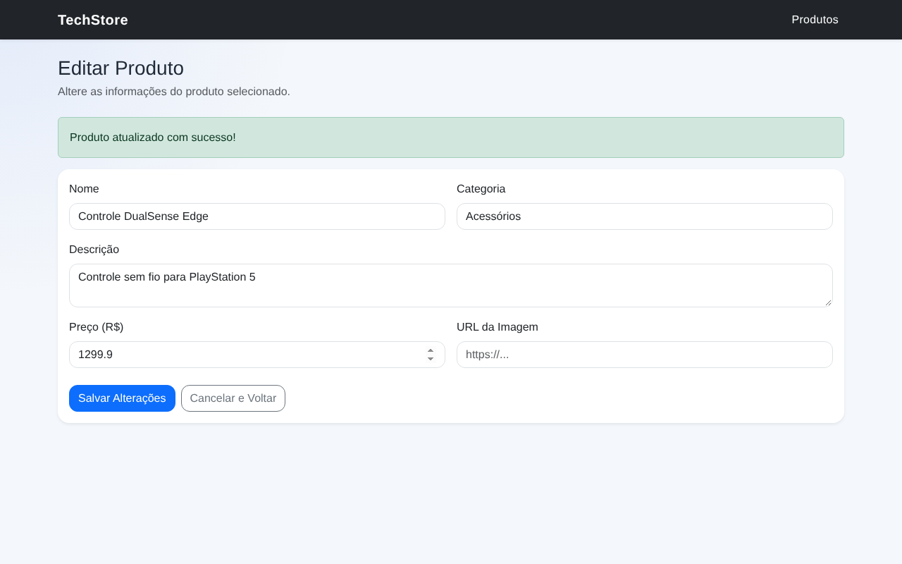
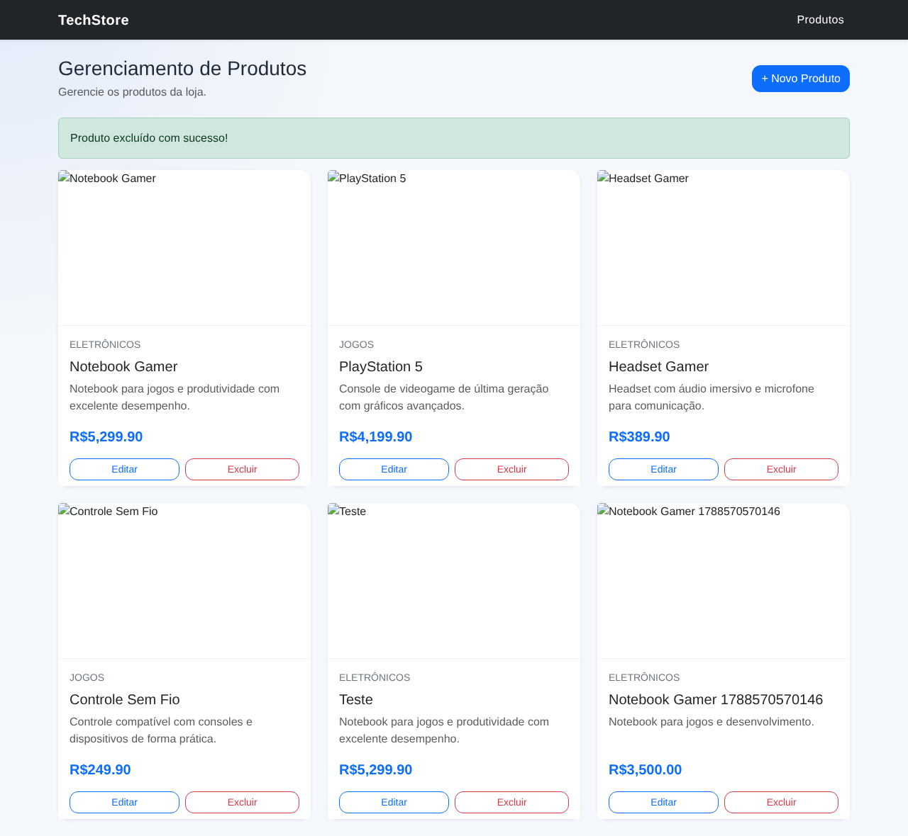
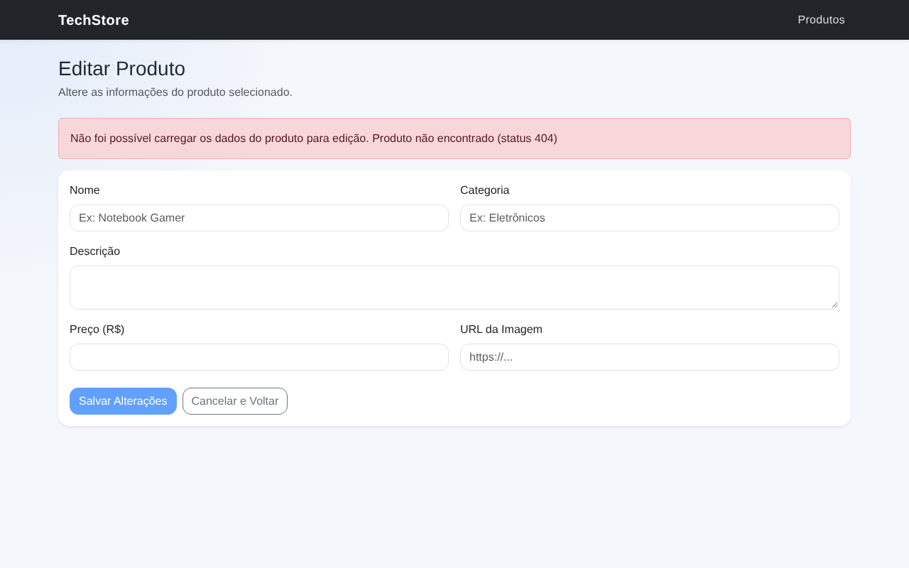
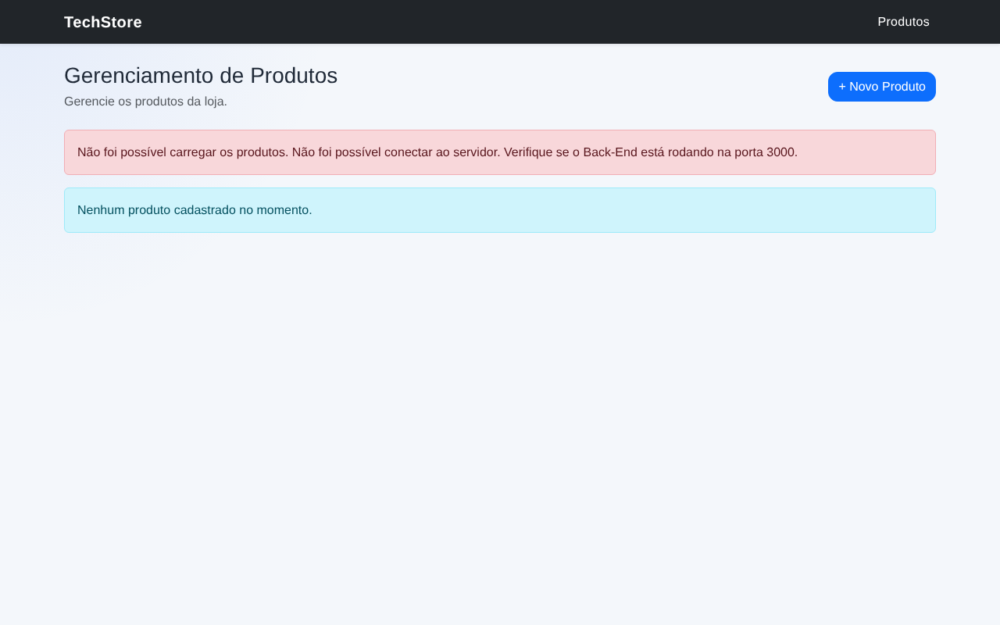

# 🎮 E-commerce de Eletrônicos e Jogos — CRUD Angular + API Node.js

Atividade da unidade curricular **Interação com APIs** (SENAI).
**Aluno:** Pedro Aquino

Uma aplicação **Angular** (front-end) integrada a uma **API REST local** em **Node.js + Express** (back-end) para gerenciar os produtos de uma loja de games: cadastro, consulta, atualização e exclusão (CRUD).

---

## 🧰 Tecnologias

| Camada | Tecnologia |
|---|---|
| Front-end | Angular, TypeScript, `HttpClient`, Reactive Forms |
| Estilização | Bootstrap 5 (importado em `frontend/src/styles.css`) |
| Back-end | Node.js, Express, CORS |
| Persistência | Arquivo JSON (`backend/data/produtos.json`) |
| Testes de API | Postman |

---

## 📁 Estrutura

```text
angular-crud-api/
├── backend/                  # API REST (Node.js + Express)
│   ├── src/server.js         # Rotas do CRUD
│   └── data/produtos.json    # "Banco de dados"
├── frontend/                 # Aplicação Angular
│   └── src/app/produtos/
│       ├── produto.service.ts         # Chamadas HTTP à API
│       ├── produto.model.ts           # Interface Produto
│       ├── lista-produtos/            # Tela de listagem + exclusão
│       └── produto-formulario/        # Tela de cadastro + edição
└── postman/
    ├── angular-crud-api.postman_collection.json   # Coleção de testes
    └── prints/                                    # Evidências dos testes
```

---

## ✅ Pré-requisitos

```bash
node -v       # v18 ou superior
npm -v
ng version    # Angular CLI (instalar: npm install -g @angular/cli)
git --version
```

Também é necessário ter **VS Code** e **Postman** instalados.

---

## ▶️ Como executar

O back-end e o front-end devem rodar **ao mesmo tempo**, em dois terminais diferentes.

**Terminal 1: Back-end**

```bash
cd backend
npm install
npm run dev
```

A API fica disponível em `http://localhost:3000/api/products`.

**Terminal 2: Front-end**

```bash
cd frontend
npm install
npm start
```

A aplicação fica disponível em `http://localhost:4200`.

---

## 🔌 Endpoints da API

Base URL: `http://localhost:3000`

| Método | Endpoint | Descrição | Sucesso | Erros |
|---|---|---|---|---|
| GET | `/api/products` | Lista todos os produtos | `200` | — |
| GET | `/api/products/:id` | Busca um produto pelo ID | `200` | `404` |
| POST | `/api/products` | Cadastra um produto | `201` | `400` |
| PUT | `/api/products/:id` | Atualiza um produto | `200` | `400`, `404` |
| DELETE | `/api/products/:id` | Exclui um produto | `204` | `404` |

**Corpo (POST/PUT):**

```json
{
  "nome": "Controle DualSense",
  "descricao": "Controle sem fio para PlayStation 5",
  "categoria": "Acessórios",
  "preco": 449.90,
  "imagem": ""
}
```

`nome`, `descricao`, `categoria` e `preco` (> 0) são obrigatórios. Em caso de erro, a API retorna `{ "erro": "mensagem" }`.

---

## 🧪 Testes no Postman

1. Abra o Postman → **Import** → selecione `postman/angular-crud-api.postman_collection.json`.
2. Com o back-end rodando, clique na coleção → **Run collection**.
3. As requisições rodam em sequência. O ID criado no POST é salvo na variável `{{produtoId}}` e reaproveitado nos passos seguintes.

| # | Requisição | Resultado esperado |
|---|---|---|
| 1 | GET – Listar produtos | 200 + array |
| 2 | POST – Cadastrar produto | 201 + produto com `id` |
| 3 | GET – Buscar por ID | 200 + produto criado |
| 4 | PUT – Atualizar produto | 200 + dados atualizados |
| 5 | DELETE – Excluir produto | 204 |
| 6 | ERRO – Buscar produto inexistente | 404 + `"Produto não encontrado"` |
| 7 | ERRO – Cadastrar dados inválidos | 400 + campo `erro` |

As evidências (prints) estão em [`postman/prints/`](postman/prints/).

---

## 🔗 Integração Front-end ↔ Back-end

Toda a comunicação fica centralizada no `ProdutoService` (`frontend/src/app/produtos/produto.service.ts`), usando o `HttpClient` do Angular (configurado com `provideHttpClient()` em `app.config.ts`):

| Método do serviço | Requisição | Usado em |
|---|---|---|
| `listar()` | `GET /api/products` | Tela de listagem |
| `buscarPorId(id)` | `GET /api/products/:id` | Formulário (modo edição) |
| `cadastrar(produto)` | `POST /api/products` | Formulário (novo produto) |
| `atualizar(id, produto)` | `PUT /api/products/:id` | Formulário (modo edição) |
| `excluir(id)` | `DELETE /api/products/:id` | Botão excluir da listagem |

---

## 💬 Tratamento de respostas e feedback ao usuário

Todas as chamadas passam pelo método `tratarErro()` do serviço, que transforma a resposta do servidor em uma mensagem clara:

| Situação | Mensagem exibida |
|---|---|
| Sucesso | Alerta **verde**: "Produto cadastrado/atualizado/excluído com sucesso!" |
| `400` / `404` | Alerta **vermelho** com a mensagem retornada pela API + status (ex.: "Produto não encontrado (status 404)") |
| Back-end desligado (status `0`) | "Não foi possível conectar ao servidor. Verifique se o Back-End está rodando na porta 3000." |
| Outros erros | "Erro inesperado no servidor (status X)." |

Os alertas usam o componente compartilhado `MensagemComponent` com as classes do Bootstrap (`alert-success` / `alert-danger`).

---

## 📸 Evidências

### Testes da API (coleção Postman executada com Newman — 7 requisições, 13 testes, 0 falhas)



### Aplicação Angular integrada à API

| Listagem (GET) | Cadastro (POST) |
|---|---|
|  |  |

| Edição (GET por ID + PUT) | Exclusão (DELETE) |
|---|---|
|  |  |

| Erro 404 (produto inexistente) | Erro de conexão (back-end desligado) |
|---|---|
|  |  |
